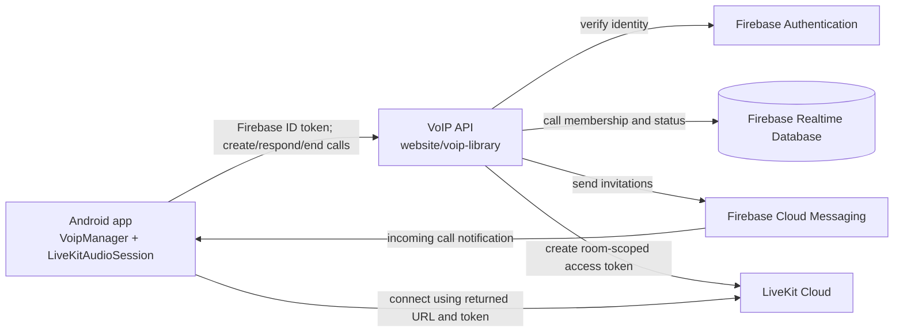

# VoIP architecture

The Android client authenticates API requests with the current Firebase user's
ID token. The API validates identity and call membership, stores signaling
state in Firebase Realtime Database, sends invitations through Firebase Cloud
Messaging, and signs LiveKit access tokens on the server. LiveKit API secrets
must remain in the server's secret configuration.

The API implementation and configuration are documented in
[the VoIP library guide](../../voip-library/readme.md). Configure
`VOIP_API_BASE_URL` in the Android project's local build properties to point
to the deployed HTTPS API origin; do not use a client-side shared API secret.
